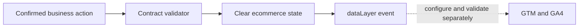

# GA4 / GTM event taxonomy

A reviewable measurement contract for an example shop: four commerce events, strict payload validation, dataLayer examples and a manual QA checklist. No tracking requests are sent. No GTM container or GA4 property is supplied.

## Example result
Each of the four events has a runnable payload in [examples.mjs](examples.mjs). A successful purchase adds:
```json
[
  {"ecommerce": null},
  {"event": "purchase", "ecommerce": {"currency": "USD", "value": 35, "items": [{"item_id": "SKU-001", "price": 17.5, "quantity": 2}], "transaction_id": "ORDER-001"}}
]
```
The same purchase a second time adds nothing. A total of 99 is rejected because the items total 35; an unknown event is rejected; failed payment sends no event. This makes developer/analyst acceptance criteria visible before connecting analytics.

## Run
Node.js 20+, no dependencies.
```sh
npm test
npm run demo
```
The demo prints all four validated events, suppresses a repeated purchase and shows three rejected payloads.

## Architecture


The implementation deliberately has stricter rules than GA4: all four events require currency, value and priced items; only SKU-* item IDs and ORDER-* transaction IDs are accepted. This is an example project contract, not a universal Google schema. Currency format validation does not validate a code against ISO 4217.

[Event contract](taxonomy.json) · [Implementation and QA](docs/architecture.md)

The in-memory duplicate guard lasts only while the supplied Set survives; it does not guarantee cross-tab, cross-device or server deduplication. No GA4 property, GTM container, consent system or live collection is configured. The allow-list reduces accidental data leakage but is not a complete PII detector. Synthetic examples only. MIT licence.

## Browser demo
```sh
python3 -m http.server 8184 --bind 127.0.0.1
```
Open http://127.0.0.1:8184. Buttons demonstrate successful events, failed payment, invalid totals, repeat purchase and reset. Stop the server with Ctrl-C. The demo only updates an on-page array; no external tracking is loaded.

## Adaptation
I would agree event triggers and revenue definitions with the shop owner, integrate the contract into confirmed business actions, then configure consent/GTM and verify delivery in Preview and DebugView. These live checks remain outside this demo.

[CI checks](https://github.com/zoercalm/ga4-gtm-event-taxonomy/actions/workflows/ci.yml)
