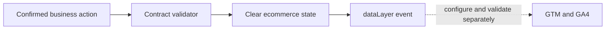

# GA4 / GTM event taxonomy

A reviewable measurement contract for an example shop: four commerce events, strict payload validation, dataLayer examples and a manual QA checklist. No tracking requests are sent.

## Run
Node.js 20+, no dependencies.
```sh
npm test
npm run demo
```
The demo prints one validated purchase preceded by `ecommerce: null`; a repeated transaction is suppressed using a shared in-memory Set.

## Architecture


The implementation deliberately has stricter rules than GA4: all four events require currency, value and priced items; only SKU-* item IDs and ORDER-* transaction IDs are accepted. This is an example project contract, not a universal Google schema. Currency format validation does not validate a code against ISO 4217.

[Event contract](taxonomy.json) · [Implementation and QA](docs/architecture.md)

The in-memory duplicate guard lasts only while the supplied Set survives; it does not guarantee cross-tab, cross-device or server deduplication. No GA4 property, GTM container, consent system or live collection is configured. The allow-list reduces accidental data leakage but is not a complete PII detector. Synthetic examples only. MIT licence.
